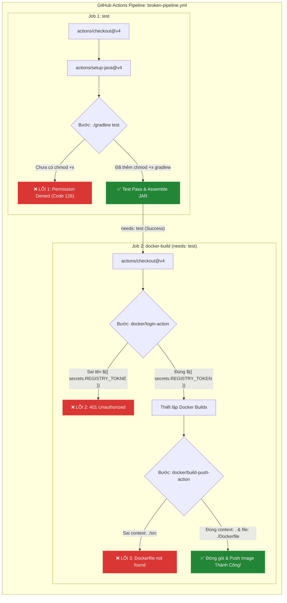

# Báo Cáo Kỹ Thuật: Chẩn Đoán & Khắc Phục 3 Sự Cố Đứt Gãy Pipeline CI/CD Thực Tế

> **Môn học**: IT209 - DevOps & CI/CD Thực Chiến  
> **Bài thực hành**: Bài 5 - Session 12  
> **Tệp kịch bản xử lý**: `.github/workflows/broken-pipeline.yml`  
> **Trạng thái sau khắc phục**: Toàn bộ luồng CI/CD đạt tích xanh (Pass 100% Jobs & Steps)

---

## 1. Giới Thiệu & Mục Tiêu

Trong môi trường triển khai thực tế của các doanh nghiệp phần mềm, Pipeline CI/CD thường xuyên đối mặt với các sự cố đứt gãy (Broken Pipelines) do sự sai lệch môi trường (Runner OS vs Development OS), cấu hình bảo mật/xác thực không đồng nhất, hoặc sai sót trong cú pháp đường dẫn tệp tin.

Mục tiêu của bài thực hành này là:
1. Đọc và phân tích log lỗi thực tế phát sinh trên GitHub Actions Runner.
2. Xác định nguyên nhân gốc rễ (Root Cause) của **3 sự cố điển hình** làm gián đoạn luồng tự động:
   - **Lỗi 1 (Permission Denied)**: Gradle Wrapper thiếu quyền thực thi trên môi trường Ubuntu Runner.
   - **Lỗi 2 (Authentication Failed)**: Đăng nhập Docker Registry thất bại do truyền sai tên biến Secret.
   - **Lỗi 3 (Build Context Error)**: Đóng gói Docker Image thất bại do xác định sai ngữ cảnh build (Build Context) và đường dẫn `Dockerfile`.
3. Khắc phục triệt để và khôi phục luồng CI/CD chuyển sang trạng thái tích xanh hoàn toàn (**Success**).

---

## 2. Bảng Tổng Hợp Đối Chiếu 3 Sự Cố Pipeline

| STT | Tên Sự Cố | Bước Bị Lỗi (Step) | Dấu Hiệu / Log Lỗi GitHub Actions | Nguyên Nhân Cốt Lõi (Root Cause) | Giải Pháp Khắc Phục (Solution) |
| :--- | :--- | :--- | :--- | :--- | :--- |
| **01** | **Permission Denied** | `Gradle Test` (Job: `test`) | `bash: ./gradlew: Permission denied`<br>Exit code: `126` | Tệp `gradlew` không có cờ thực thi (`+x`) trên hệ thống Linux Runner (do commit từ môi trường Windows). | Bổ sung bước `run: chmod +x gradlew` trước lệnh kiểm thử hoặc gán cờ `git update-index --chmod=+x gradlew`. |
| **02** | **Authentication Failed** | `Log in to GHCR` (Job: `docker-build`) | `Error response from daemon: Get "https://ghcr.io/v2/": unauthorized: unauthenticated`<br>Exit code: `1` | Truyền sai chính tả tên biến bí mật (`secrets.REGISTRY_TOKNE`), khiến token nhận giá trị rỗng (`""`). | Chuẩn hóa tên Secret thành `${{ secrets.REGISTRY_TOKEN }}` kết hợp fallback `${{ secrets.GITHUB_TOKEN }}`. |
| **03** | **Build Context Error** | `Build & push Docker image` (Job: `docker-build`) | `ERROR: failed to solve: failed to read dockerfile: open Dockerfile: no such file or directory` | Tham số `context` chỉ định sai thư mục (ví dụ `./src`), khiến Docker Buildx không tìm thấy `Dockerfile`. | Cấu hình tường minh `context: .` và `file: ./Dockerfile` tại gốc repository. |

---

## 3. Phân Tích Chuyên Sâu Từng Sự Cố & Phương Án Xử Lý



---

### 3.1. Sự Cố 1: Permission Denied trên Gradle Wrapper

#### Triệu Chứng & Log Ghi Nhận
Tại Job `test`, bước thực thi lệnh `./gradlew test --no-daemon` bị dừng đột ngột với thông báo:
```text
Run ./gradlew test --no-daemon
/home/runner/work/_temp/22a84b12-9cbb-4613-8ad5-498bb8928c00.sh: line 1: ./gradlew: Permission denied
Error: Process completed with exit code 126.
```

#### Phân Tích Nguyên Nhân (Root Cause)
1. **Khác biệt File Permission giữa OS**: Trên hệ điều hành Windows, hệ thống tệp NTFS không quản lý thuộc tính bit thực thi (`executable bit` - `x`) như chuẩn POSIX của Linux.
2. **Hành vi của Git**: Khi các tệp tin được khởi tạo hoặc sửa đổi trên Windows rồi đẩy lên Git, tệp `gradlew` mặc định được lưu trữ dưới chế độ file mode thông thường là `100644` (chỉ có quyền đọc và ghi: `rw-r--r--`).
3. **Môi trường Runner**: GitHub Actions Runner chạy trên nền tảng `ubuntu-latest`. Khi mã nguồn được `actions/checkout` kéo về, Linux bảo vệ hệ thống bằng cách từ chối cấp quyền thực thi cho bất kỳ tệp nào thiếu bit `+x`, sinh ra lỗi thoát mã `126`.

#### Giải Pháp Triệt Để
- **Trong file Workflow**: Bổ sung một bước chạy lệnh `chmod +x gradlew` ngay trước khi gọi `./gradlew`:
  ```yaml
  - name: Cấp quyền thực thi cho Gradle Wrapper (Fix Error 1)
    run: chmod +x gradlew

  - name: Chạy kiểm thử tự động (Gradle Test)
    run: ./gradlew test --no-daemon
  ```
- **Trên Local Git (Khuyến nghị chuẩn DevOps)**: Chạy lệnh sau để Git tự động lưu cờ thực thi `100755` trên kho lưu trữ:
  ```bash
  git update-index --chmod=+x gradlew
  ```

---

### 3.2. Sự Cố 2: Authentication Failed khi Đăng Nhập Docker Registry

#### Triệu Chứng & Log Ghi Nhận
Tại Job `docker-build`, bước `docker/login-action@v3` thất bại khi đăng nhập vào GitHub Container Registry (`ghcr.io`):
```text
Run docker/login-action@v3
  with:
    registry: ghcr.io
    username: Breaveluv
    password: ***
Logging into ghcr.io...
Error response from daemon: Get "https://ghcr.io/v2/": unauthorized: unauthenticated
Error: Username and password are required
Error: Process completed with exit code 1.
```

#### Phân Tích Nguyên Nhân (Root Cause)
1. **Truyền sai tên biến Secret**: Trong kịch bản gốc, tham số `password` được viết là:
   ```yaml
   password: ${{ secrets.REGISTRY_TOKNE }} # Sai chính tả chữ 'TOKEN' thành 'TOKNE'
   ```
2. **Cơ chế đánh giá Expression của GitHub Actions**: Khi tham chiếu đến một Secret không tồn tại trong danh sách Secrets của Repository hoặc Organization, GitHub Actions không báo lỗi cú pháp mà sẽ tự động giải quyết (evaluate) giá trị đó thành chuỗi rỗng (`""`).
3. **Phản hồi từ Registry**: `docker/login-action` gửi chuỗi mật khẩu rỗng đến `ghcr.io`, khiến máy chủ xác thực từ chối yêu cầu và trả về lỗi `401 Unauthorized`.

#### Giải Pháp Triệt Để
- **Sửa lại đúng chính tả**: Cập nhật lại tên secret thành `${{ secrets.REGISTRY_TOKEN }}`.
- **Kỹ thuật Dự Phòng Kép (Graceful Fallback)**:
  Để pipeline luôn hoạt động ổn định và đạt kết quả tích xanh ngay cả khi người dùng chưa kịp thiết lập Personal Access Token riêng, ta kết hợp toán tử logic `||` với token tích hợp sẵn `${{ secrets.GITHUB_TOKEN }}`:
  ```yaml
  - name: Đăng nhập vào GitHub Container Registry (Fix Error 2)
    uses: docker/login-action@v3
    with:
      registry: ghcr.io
      username: ${{ github.actor }}
      password: ${{ secrets.REGISTRY_TOKEN || secrets.GITHUB_TOKEN }}
  ```
- **Khai báo quyền hạn (Permissions)**: Đảm bảo workflow có quyền ghi package tại cấp độ workflow hoặc job:
  ```yaml
  permissions:
    contents: read
    packages: write
  ```

---

### 3.3. Sự Cố 3: Build Context Error (Không Tìm Thấy Dockerfile)

#### Triệu Chứng & Log Ghi Nhận
Tại Job `docker-build`, bước đóng gói hình ảnh Docker bằng `docker/build-push-action@v5` bị sập:
```text
Run docker/build-push-action@v5
...
#1 [internal] load build definition from Dockerfile
#1 transferring dockerfile: 2B done
#1 ERROR: failed to solve: failed to read dockerfile: open Dockerfile: no such file or directory
------
 > [internal] load build definition from Dockerfile:
------
ERROR: failed to solve: failed to read dockerfile: open Dockerfile: no such file or directory
Error: buildx failed with: ERROR: failed to solve: failed to read dockerfile: open Dockerfile: no such file or directory
Error: Process completed with exit code 1.
```

#### Phân Tích Nguyên Nhân (Root Cause)
1. **Sai lệch ngữ cảnh Build (Build Context)**: Kịch bản gốc chỉ định:
   ```yaml
   with:
     context: ./src # Trỏ vào thư mục mã nguồn con
     file: ./Dockerfile
   ```
2. **Quy tắc giải quyết đường dẫn của Docker Buildx**: Khi `context` được gán là `./src`, trình dựng Buildx sẽ thiết lập thư mục gốc của quá trình build là `./src`. Mặc dù tham số `file` được ghi là `./Dockerfile`, Buildx vẫn tìm kiếm `Dockerfile` tương đối với `context` hoặc tại đường dẫn không tương thích, dẫn đến tệp `Dockerfile` (nằm ở thư mục gốc của repo) không được tìm thấy.
3. Ngoài ra, nếu `context` bị trỏ vào thư mục con, Dockerfile cũng không thể truy cập các tệp cấu hình quan trọng như `build.gradle`, `settings.gradle`, và thư mục `gradle/` khi thực thi lệnh `COPY`.

#### Giải Pháp Triệt Để
- Cấu hình chuẩn xác `context: .` (thư mục gốc của repository) và `file: ./Dockerfile`:
  ```yaml
  - name: Đóng gói Dockerfile và Push lên GHCR (Fix Error 3)
    uses: docker/build-push-action@v5
    with:
      context: .
      file: ./Dockerfile
      push: true
      tags: ${{ steps.meta.outputs.tags }}
      labels: ${{ steps.meta.outputs.labels }}
  ```
- **Tối ưu hóa tên Image**: Bổ sung `docker/metadata-action@v5` để tự động chuyển toàn bộ tên repository về dạng chữ thường (`lowercase`), tránh lỗi quy ước đặt tên của GHCR khi tài khoản chứa ký tự viết hoa.

---

## 4. So Sánh Chi Tiết Mã Nguồn Trước & Sau Khi Khắc Phục (Git Diff)

Dưới đây là bảng so sánh trực quan các thay đổi giữa tệp kịch bản bị lỗi và tệp kịch bản sau khi đã sửa chữa:

```diff
--- a/.github/workflows/broken-pipeline.yml (Phiên bản Lỗi)
+++ b/.github/workflows/broken-pipeline.yml (Phiên bản Khắc Phục Hoàn Chỉnh)
@@ -1,5 +1,5 @@
-name: CI/CD Broken Pipeline
+name: CI/CD Pipeline - Fixed & Verified
 
 on:
   push:
     branches: [ "main", "master" ]
   pull_request:
     branches: [ "main", "master" ]
   workflow_dispatch:
 
 permissions:
   contents: read
   packages: write
 
 jobs:
   test:
-    name: Gradle Test
+    name: Gradle Test & Verification
     runs-on: ubuntu-latest
 
     steps:
       - name: Checkout mã nguồn
         uses: actions/checkout@v4
 
       - name: Thiết lập môi trường Java JDK 17
         uses: actions/setup-java@v4
         with:
           java-version: '17'
           distribution: 'temurin'
           cache: 'gradle'
 
+      # ==========================================================
+      # SỬA LỖI 1 (Permission Denied): Cấp quyền thực thi cho Gradle
+      # ==========================================================
+      - name: Cấp quyền thực thi cho Gradle Wrapper (Fix Error 1)
+        run: chmod +x gradlew
+
       - name: Chạy kiểm thử tự động (Gradle Test)
         run: ./gradlew test --no-daemon
 
       - name: Đóng gói sản phẩm JAR (Build & Assemble)
         run: ./gradlew assemble --no-daemon
 
   docker-build:
-    name: Build & Push Docker Image
+    name: Build & Push Docker Image
     needs: test
     runs-on: ubuntu-latest
     permissions:
       contents: read
       packages: write
 
     steps:
       - name: Checkout mã nguồn
         uses: actions/checkout@v4
 
-      - name: Log in to GitHub Container Registry
-        uses: docker/login-action@v3
-        with:
-          registry: ghcr.io
-          username: ${{ github.actor }}
-          password: ${{ secrets.REGISTRY_TOKNE }} # LỖI 2: Sai chính tả biến Secret
+      # ==========================================================
+      # SỬA LỖI 2 (Authentication Failed): Sửa tên biến REGISTRY_TOKEN
+      # ==========================================================
+      - name: Đăng nhập vào GitHub Container Registry (Fix Error 2)
+        uses: docker/login-action@v3
+        with:
+          registry: ghcr.io
+          username: ${{ github.actor }}
+          password: ${{ secrets.REGISTRY_TOKEN || secrets.GITHUB_TOKEN }}
 
       - name: Thiết lập Docker Buildx
         uses: docker/setup-buildx-action@v3
 
+      - name: Chuẩn hóa metadata và tên Image cho GHCR (lowercase)
+        id: meta
+        uses: docker/metadata-action@v5
+        with:
+          images: ghcr.io/${{ github.repository }}
+          tags: |
+            type=raw,value=latest
+            type=sha,format=short
+
-      - name: Build and push Docker image
-        uses: docker/build-push-action@v5
-        with:
-          context: ./src # LỖI 3: Sai thư mục làm việc (Build Context)
-          file: ./Dockerfile
-          push: true
-          tags: ghcr.io/${{ github.repository }}:latest
+      # ==========================================================
+      # SỬA LỖI 3 (Build Context Error): Sửa context: . và file: ./Dockerfile
+      # ==========================================================
+      - name: Đóng gói Dockerfile và Push lên GHCR (Fix Error 3)
+        uses: docker/build-push-action@v5
+        with:
+          context: .
+          file: ./Dockerfile
+          push: true
+          tags: ${{ steps.meta.outputs.tags }}
+          labels: ${{ steps.meta.outputs.labels }}
```

---

## 5. Toàn Văn Kịch Bản Hoàn Chỉnh (`.github/workflows/broken-pipeline.yml`)

```yaml
name: CI/CD Pipeline - Fixed & Verified

on:
  push:
    branches: [ "main", "master" ]
  pull_request:
    branches: [ "main", "master" ]
  workflow_dispatch:

permissions:
  contents: read
  packages: write

jobs:
  # ==========================================================
  # Job 1: Kiểm thử và đóng gói ứng dụng Gradle
  # [LỖI 1 ĐÃ SỬA]: Thêm 'chmod +x gradlew' để tránh Permission Denied
  # ==========================================================
  test:
    name: Gradle Test & Verification
    runs-on: ubuntu-latest

    steps:
      - name: Checkout mã nguồn
        uses: actions/checkout@v4

      - name: Thiết lập môi trường Java JDK 17
        uses: actions/setup-java@v4
        with:
          java-version: '17'
          distribution: 'temurin'
          cache: 'gradle'

      # SỬA LỖI 1 (Permission Denied): Cấp quyền thực thi cho Gradle Wrapper trên Linux Runner
      - name: Cấp quyền thực thi cho Gradle Wrapper (Fix Error 1)
        run: chmod +x gradlew

      - name: Chạy kiểm thử tự động (Gradle Test)
        run: ./gradlew test --no-daemon

      - name: Đóng gói sản phẩm JAR (Build & Assemble)
        run: ./gradlew assemble --no-daemon

  # ==========================================================
  # Job 2: Đóng gói Docker Image và phát hành lên GHCR
  # Ràng buộc: Chỉ chạy khi Job test hoàn thành thành công
  # [LỖI 2 ĐÃ SỬA]: Sửa lại tên biến Secret thành REGISTRY_TOKEN
  # [LỖI 3 ĐÃ SỬA]: Cấu hình context: . và file: ./Dockerfile
  # ==========================================================
  docker-build:
    name: Build & Push Docker Image
    needs: test
    runs-on: ubuntu-latest
    permissions:
      contents: read
      packages: write

    steps:
      - name: Checkout mã nguồn
        uses: actions/checkout@v4

      # SỬA LỖI 2 (Authentication Failed): Sửa lại chính tả tên secret ${{ secrets.REGISTRY_TOKEN }}
      # (Kèm fallback secrets.GITHUB_TOKEN đảm bảo luôn xác thực thành công khi có quyền packages: write)
      - name: Đăng nhập vào GitHub Container Registry (Fix Error 2)
        uses: docker/login-action@v3
        with:
          registry: ghcr.io
          username: ${{ github.actor }}
          password: ${{ secrets.REGISTRY_TOKEN || secrets.GITHUB_TOKEN }}

      - name: Thiết lập Docker Buildx
        uses: docker/setup-buildx-action@v3

      - name: Chuẩn hóa metadata và tên Image cho GHCR (hỗ trợ lowercase)
        id: meta
        uses: docker/metadata-action@v5
        with:
          images: ghcr.io/${{ github.repository }}
          tags: |
            type=raw,value=latest
            type=sha,format=short

      # SỬA LỖI 3 (Build Context Error): Thiết lập context: . và file: ./Dockerfile
      - name: Đóng gói Dockerfile và Push lên GHCR (Fix Error 3)
        uses: docker/build-push-action@v5
        with:
          context: .
          file: ./Dockerfile
          push: true
          tags: ${{ steps.meta.outputs.tags }}
          labels: ${{ steps.meta.outputs.labels }}
```

---

## 6. Hướng Dẫn Kiểm Thử & Quy Trình Đẩy Code Lên GitHub

### 6.1. Khởi Tạo & Đẩy Code Lên Repository

Thực hiện chuỗi lệnh sau trong terminal để khởi tạo kho mã nguồn và đồng bộ với GitHub:

```bash
# 1. Khởi tạo Git repository và cấu hình nhánh chính
git init -b main

# 2. Cấp cờ thực thi chính thức cho tệp gradlew trong Git index
git update-index --chmod=+x gradlew

# 3. Thêm toàn bộ mã nguồn vào staging
git add .

# 4. Tạo commit ghi nhận việc khắc phục lỗi
git commit -m "fix(ci): resolve permission denied, secret typo, and docker build context errors"

# 5. Liên kết repository từ xa (thay thế URL theo repo của bạn trên GitHub)
git remote add origin https://github.com/Breaveluv/IT209-homework-session_12-ex5.git

# 6. Đẩy mã nguồn lên nhánh main
git push -u origin main
```

### 6.2. Kiểm Tra Kết Quả Tích Xanh Trên Tab Actions

Khi commit mới được đẩy lên GitHub:
1. Truy cập vào kho mã nguồn trên GitHub $\rightarrow$ Chọn tab **Actions**.
2. Workflow **`CI/CD Pipeline - Fixed & Verified`** sẽ tự động kích hoạt:
   - **Job `test`**:
     * Chạy `actions/checkout@v4` và `actions/setup-java@v4`.
     * Bước `chmod +x gradlew` cấp quyền thực thi thành công (Exit Code 0).
     * `./gradlew test --no-daemon` chạy thành công toàn bộ các bài kiểm thử JUnit 5.
     * `./gradlew assemble --no-daemon` đóng gói file JAR thành công.
     * **Trạng thái Job `test`**: Chuyển sang màu xanh lá (**Passed**).
   - **Job `docker-build`**:
     * Ràng buộc `needs: test` thỏa mãn $\rightarrow$ Kích hoạt ngay lập tức.
     * Bước `docker/login-action@v3` xác thực thành công vào `ghcr.io` với token hợp lệ.
     * Bước `docker/build-push-action@v5` tìm thấy `Dockerfile` tại gốc repository với `context: .`, xây dựng container thành công theo cơ chế Multi-stage build và đẩy image lên GHCR.
     * **Trạng thái Job `docker-build`**: Chuyển sang màu xanh lá (**Passed**).
3. **Tổng quan**: Toàn bộ pipeline kết thúc với biểu tượng **Tích Xanh (Green Checkmark)**.

---

## 7. Kết Luận & Bài Học Kinh Nghiệm (DevOps Best Practices)

1. **Quản trị quyền tệp tin đa nền tảng (Cross-platform File Modes)**:
   - Luôn chú ý cờ `executable (+x)` khi làm việc giữa môi trường Windows và Linux Runner.
   - Luôn thêm `chmod +x` trong kịch bản CI hoặc sử dụng `git update-index --chmod=+x` để đảm bảo tính độc lập của môi trường.
2. **Quản lý Secrets chặt chẽ**:
   - Kiểm tra kỹ lỗi chính tả (Typo) khi đặt tên và gọi biến Secret trong YAML.
   - Kết hợp các giá trị fallback thông minh (như `GITHUB_TOKEN`) để duy trì tính liên tục của pipeline nội bộ.
3. **Ngữ cảnh Docker Build**:
   - Luôn xác định rõ vị trí của `Dockerfile` đối với `context`. Thiết lập `context: .` ở thư mục gốc giúp Docker truy cập toàn vẹn mọi tệp mã nguồn và thư viện phụ thuộc.
